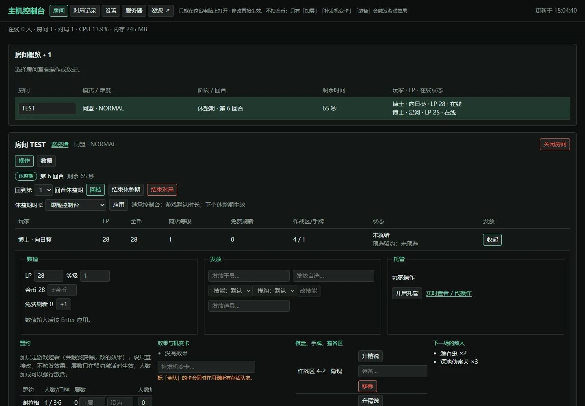
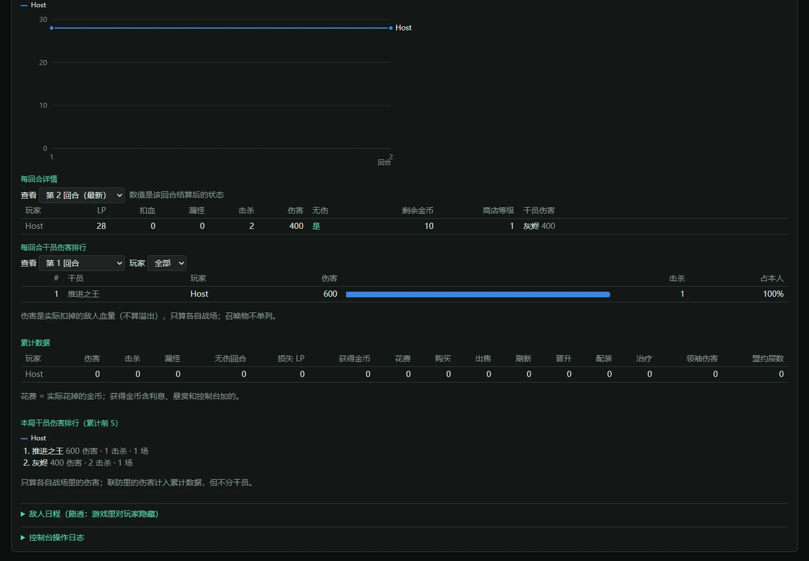
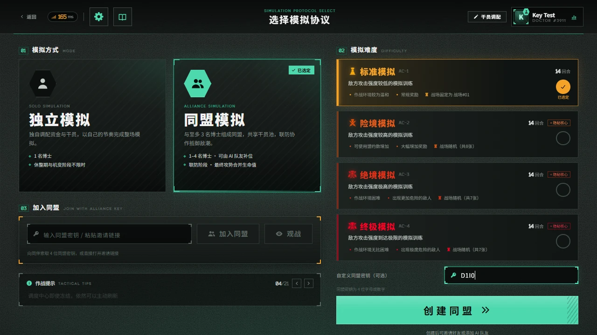
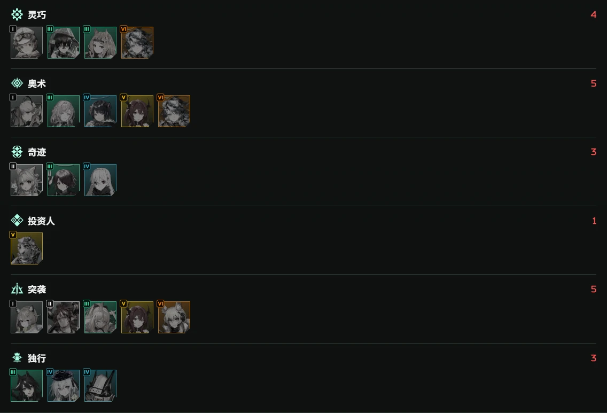
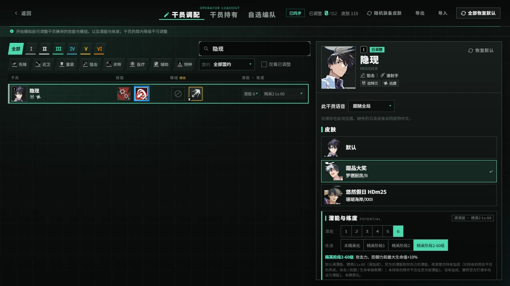

# 卫戍协议：盟约 · Stronghold Protocol: Alliance


A non-commercial fan remake of the Arknights mode *Stronghold Protocol: Alliance*, with host tools, collab operators and optional skins.

在浏览器里招募干员、布置阵容，与朋友合作迎敌。游戏提供独立模拟与 1–4 人同盟模拟，空位可由 AI 队友补齐。本库是面向自行开服的扩展分支，在上游之上加入主机控制台、休整期回档、整局回放、房间聊天与战场标点、联动自选干员、可选皮肤和控制台一键更新等功能。

[下载本库整合包](https://github.com/zhewang448/Stronghold-Protocol/releases/latest) · [扩展更新记录](docs/LOCAL-CHANGELOG.md) · [玩法指南](docs/PLAYING.md) · [反馈问题](https://github.com/zhewang448/Stronghold-Protocol/issues)

> 当前源码已合入上游 **`0.3.0`**，游戏内基础版本显示 `0.3.0`；当前版本为 **`v0.3.0-extended.2`**，扩展修订号以下载页标签和附件文件名为准。本版合入上游 0.3.0 的插件工作台、官方战斗特效、英 / 韩 / 本土配音与作战统计等改动，补齐玩法扩展的**复活队友**与**共享血条**两项开关，并保留主机控制台、四席监控墙、重启恢复、聊天与战场标点、DPS 面板、素材预载和战斗倍速；0.3.0 新增的配音与特效素材需按 [部署说明](docs/DEPLOY.md#本库扩展版的素材基线)补齐。各版内容见[扩展更新记录](docs/LOCAL-CHANGELOG.md)，上游改动见 [CHANGELOG.md](CHANGELOG.md)。
>
> 非官方、非商业同人项目，与《明日方舟》官方无隶属或授权关系。游戏名称、美术、音频、文本与数据的权利归原权利人；仅供学习和个人非商业使用。

## 本库特色

| 类别 | 功能 |
| --- | --- |
| [主机控制台](#主机控制台) | 修改数值与阵容、发放干员道具、实时查看与代操作、休整期回档、敌人日程、规则设置、重启 / 关闭服务 |
| [统计与整局回放](#统计对局记录与整局回放) | 回合曲线、干员伤害排行、历史对局、最近 50 局战斗回放、数据清理 |
| [联机交流](#文字聊天与战场标点) | 房间文字聊天、五种带名战场标点、[自定义同盟密钥](#自定义同盟密钥)、[禁用干员按盟约分组](#禁用干员按盟约分组) |
| [干员与外观](#联动自选干员) | 7 名联动自选干员、174 套可选皮肤、随机装备皮肤、素材预加载 |
| [开服与更新](#一键开服与控制台更新) | Windows 一键开服与公网隧道、控制台检查 / 安装 Release、签名校验 |

以下截图来自本库真实界面，使用测试房间和演示数据；部分截图裁剪了无关区域。

### 主机控制台

控制台运行在开服电脑本机，用于查看房间与玩家、调试阵容和管理对局。地址见启动日志的 `Console:` 行，默认 `http://127.0.0.1:3100`。



- **对局管理**：结束休整期、暂停 / 继续独立模拟、判定战斗胜负（客户端战斗模式）、单独设置房间休整期时长、结束对局与关闭房间。
- **玩家调整**：修改 LP、金币、商店等级与免费刷新；盟约加层、设层或加人数；切换托管；查看和删除效果与悬赏，补发机变卡；编辑棋盘（升为精锐、不受阶段限制地装备、移除干员）。
- **发放**：发放干员和道具；发放自选干员时选择阶级、普通 / 精锐、技能与模组，也可改已有自选干员的技能。超过共享库存时弹窗确认，点「是，强制加入」才发放，仍遵守手牌和整备区容量。
- **实时查看与代操作**：从玩家行打开，复用游戏界面约每 500 ms 同步商店、棋盘和对局状态。默认只读；勾选「开启代操作」后可购买、刷新、布阵、装备、选卡和准备，遵守普通规则并正常扣金币。实时页还原服务器状态，不是屏幕共享，也不接管玩家身份或结算；AI、已退出或淘汰玩家只可查看。
- **休整期回档**：每次进入休整期自动保存快照，可回到任一回合的休整期开始，随机数状态、统计与首领搭档一并恢复。对局结束后不能回档。默认启用重启恢复，同版本重启后回到最近休整期开始，保留当时机变并重打本回合。
- **敌人日程**：查看每回合候选组合、概率与实际出怪，并指定敌人组合。面板含剧透，默认折叠。
- **规则设置**：休整期时长可按倍率、统一秒数、逐回合或不限时设置；可选联防叠层默认关闭，开启后援助干员在联防中重新获得叠层额度。设置对所有房间生效，重启后保留。
- **聊天管理**：向本房间或全部房间发主机公告，清空聊天、禁言 / 解除禁言、踢出玩家或观战者；清空和踢出需确认。
- **监控墙与资源**：房间监控墙同时展示四席完整游戏画面，包含棋盘、商店、盟约与实时战斗，可全屏或单独观察，始终只读；资源页显示 CPU、内存、流量、连接和玩家 RTT，最多保留 10 分钟。
- **空闲自动更新**：设置中主动开启后，每小时检查已签名正式新版，无活动对局时先公告 60 秒；有新局则取消倒计时。
- **操作日志**：每个房间保留最近 100 条控制台操作，失败的也记录。
- **服务控制**：顶部「重启服务」「关闭服务」确认后断开连接并释放端口；启用恢复时保留最近休整期快照，重启完成自动刷新。外部守护程序的停止策略见[部署说明](docs/DEPLOY.md#从控制台重启--关闭服务)。

除代操作外，主机修改直接生效、不扣金币，使用前请与同局玩家约定。控制台只监听本机 `127.0.0.1` 并校验 token，不会随局域网地址或公网隧道开放；`SP_ADMIN_PORT` 改端口，`SP_ADMIN=0` 关闭。实现与接口见[扩展开发笔记](docs/LOCAL-DEV.md)。

### 统计、对局记录与整局回放

控制台新增漏怪明细、收入 / 支出来源与次数、激活盟约层数曲线；记录页可按时间、模式和难度筛选跨局胜率、干员和盟约使用情况、伤害排行。旧记录缺失字段不推算。玩家与控制台升级后会显示更新记录，首次访问只记录当前版本。

控制台提供 LP / 金币回合曲线、逐回合详情（敌人组合、扣血、漏怪、击杀）、累计及单回合干员伤害排行，可按玩家筛选；自选和补位干员按实际干员名称统计。对局结束后记录保存到 `logs/results/`，在「对局记录」中回看。



整局回放默认开启，保存最近 50 局到 `logs/replays/`。「对局记录 → 回放」按回合查看实际阵容、敌人和结果，播放普通战斗与联防，支持暂停、继续、重播和 1/2/4/8 倍速，结束后核对是否与记录一致。最终攻势与隐秘核心（第 14、15 回合）可确认后尝试播放，但录制不含实时共享血池和全队生命同步，结果可能不同；版本变化时也需确认。记录页可删除单局，「设置 → 数据清理」可分别清理对局结果、回放和操作日志。

图中数据用于展示界面。主机记录与游戏内「统计（本机）」各自保存；后者存放在玩家浏览器里，可导入和导出。

### 文字聊天与战场标点

房间文字聊天贯穿等待室与对局，保存最近 50 条消息，支持重连历史、未读提醒和草稿；每条最多 200 字，观战席只读。

拖动文字聊天按钮或展开后的标题即可更改位置，也可用方向键微调，并在面板内恢复默认。位置按当前浏览器、站点和玩家名分别保存，同名下次登录自动恢复；换设备或站点不共享。

战场标点有注意、进攻、危险、撤退和问号五种，在左下角选择后点棋盘格发送。观察同一战场的玩家和观战者都能看见，标点上方显示发送者名字，带落点动画和分类音效，2.5 秒后消失。聊天和标点不进入战斗模拟、回档或回放。

### 自定义同盟密钥

创建同盟时可填写 **4 位英文字母或数字**，不区分大小写；留空自动生成。密钥被占用时会提示更换，房间解散后可再次使用。



### 禁用干员按盟约分组

开局简报、策略选择弹窗与局内「本局信息」按盟约显示禁用干员，配有盟约图标、名称、人数和头像，组内按阶级排列。多盟约干员在各所属盟约下显示，禁用总数去重计算。



### 联动自选干员

自选池共 **79 名**干员，比上游多出 **灰烬、艾拉、麒麟R夜刀、玛露西尔、丰川祥子、结城理、焰狐龙梓兰**这 7 名联动干员，可在「干员调配 → 自选编队」配置，也可由控制台发放。部分专属视觉效果和外语文本尚未完成，见[联动实现说明](docs/LOCAL-DEV.md#8-联动干员进自选池)。

### 可选皮肤与素材预加载

皮肤目录覆盖 **115 名干员、174 套皮肤**。安装资源后在调配或自选面板选择外观，或用「随机装备皮肤」为干员随机选用已安装的非默认皮肤。选择可随调配文件导入 / 导出，并在联机、重连和观战中同步。



皮肤只改变外观，不改变战斗数值或战斗哈希；商店、奖励和详情页半身立绘仍使用默认资源。设置里可手动预加载画面素材或全部素材，查看进度并取消。详见[皮肤说明](docs/SKINS.md)。

### 一键开服与控制台更新

- **一键开服**：Windows 运行 `scripts/start-tunnel.bat`，同时启动游戏和 cloudflared 临时隧道，显示本机、局域网和公网地址；`scripts/stop-server.bat` 释放端口。用法见[和朋友一起玩](#和朋友一起玩)。
- **控制台更新**：每次启动后首次打开控制台会检查本库 Release，有新版时提醒；「设置 → 版本更新」可选择新版本或回退旧版本，自动下载、校验、备份、安装并重启。支持 HTTP / HTTPS 代理和备用镜像，安装保留本机素材、设置和对局记录。
- **签名校验**：发布附件附带 `SHA256SUMS.txt` 的 Ed25519 签名，控制台验证签名后再核对安装包，经镜像下载也能确认来源。

自动更新从 `v0.2.5-extended.2` 起提供，只替换程序，新增素材需另行补齐。使用方法见[部署说明](docs/DEPLOY.md#本库拓展版控制台下载并安装)。

## 开始运行

需要 **Node.js 22 或 24** 和支持 WebGL 的现代浏览器；Windows、macOS、Linux 均可开服。手机建议横屏游玩，战斗在玩家浏览器中模拟，设备性能会影响流畅度。

### 下载整合包

从[本库 Releases](https://github.com/zhewang448/Stronghold-Protocol/releases)选择附件，解压到新目录：

| 附件 | 适合的情况 |
| --- | --- |
| `*-assets.zip` | 带游戏代码、运行依赖、11 个官方战场场景、官方 3D 棋盘、40 组召唤物模型、中文 / 日文语音等本地素材与 174 套可选皮肤，适合希望直接启动的玩家 |
| `*-lite.zip` | 带同版代码与运行依赖，首次启动时联网下载默认素材；官方战场场景、棋盘等本地素材和可选皮肤需另行导入 / 安装 |
| `SHA256SUMS.txt` | 用于核对安装包的 SHA-256 校验值 |
| `SHA256SUMS.txt.sig` | 维护者对校验值的 Ed25519 签名，控制台更新据此确认安装包来自本库；更早的版本没有此附件 |

- **Windows**：双击 `scripts/start-windows.bat`。
- **macOS / Linux**：在解压后的项目目录运行 `bash scripts/start.sh`。

脚本会检查环境与素材、启动服务器并打开浏览器。默认游戏地址为 `http://localhost:3000`，控制台地址见启动日志的 `Console:` 行。

### 升级

从旧版首次升级到本版时，先停止服务器，解压新包到新目录，再把旧目录 `logs/` 中需要的记录和设置迁移过去。之后可在控制台更新；手动安装时有活动对局仍需确认结束。恢复文件绑定版本及规则指纹，升级后不保证可恢复，建议打完再升级。本版沿用 `v0.2.5-extended.1` 的完整素材，已有完整素材无需重新下载。详见[部署说明](docs/DEPLOY.md#本库拓展版控制台下载并安装)。

### 从源码运行

```powershell
git clone https://github.com/zhewang448/Stronghold-Protocol.git
cd Stronghold-Protocol
npm install
npm run setup
npm start
```

`setup` 准备数据和默认素材；下载中断后可重新运行续传。网络下载失败时可尝试：

```powershell
node tools/setup.mjs --asset-source=mirror
```

需要皮肤时另外安装，然后重启服务器并刷新游戏页面：

```powershell
node tools/install-skins.mjs --all
```

安装选项与失败重试见[皮肤说明](docs/SKINS.md)。启动有问题时运行 `npm run doctor`，检查 Node 版本、素材、端口与网络配置。

### 官方本地素材

表情和「玩法说明」的教程图随上面的素材一起从公开镜像下载。源码和轻量包的默认下载流程不含官方战场场景、3D 棋盘、召唤物模型等本地素材；缺少场景时 3D 棋盘回退为金属地块。可从**同一基础版本**的上游完整包复制 `public/assets/local/` 和 `data/local-assets.json`，或从本机游戏客户端提取，具体见[部署说明 §6](docs/DEPLOY.md#6-本地客户端素材可选)。

## 和朋友一起玩

1. 主机启动服务器，将启动日志里的**局域网游戏地址**发给朋友；同一网络的玩家在浏览器里打开它。
2. 选择「同盟模拟」并创建同盟，分享 4 位密钥或邀请链接。
3. 等待朋友加入，或加入 AI 队友填补空位，再开始对局。

不在同一局域网时，Windows 可用本库开服脚本生成临时公网地址。先安装 Node.js 与 cloudflared，并完成游戏环境准备：

```powershell
winget install Cloudflare.cloudflared
.\scripts\start-tunnel.bat
```

脚本会先结束占用游戏端口的旧服务器 / 隧道，再启动游戏与 cloudflared，显示本机、局域网和公网地址。临时隧道地址每次启动可能变化；按 `Ctrl+C` 或关闭窗口停止。可用 `--port 3001` 改游戏端口，或用 `--no-tunnel` 只开局域网。后台常驻与脚本参数见[开服脚本说明](scripts/README.md)，虚拟局域网、端口转发等其他方式见[部署说明](docs/DEPLOY.md)。

自建反向代理需要转发 WebSocket `/ws`，并在域名根路径运行单个常驻 Node.js 实例。游戏没有账号系统，知道游戏地址的人即可进入。主机控制台留在开服电脑本机使用。

刷新或断线后，同盟模拟可在 **10 分钟**内重连，独立模拟可在 **24 小时**内恢复原座位，前提是服务器和该对局仍在运行。默认每次休整期保存本机恢复文件；同版本重启后恢复进行中的对局，回到最近休整期开始，保留当时机变，作战中重启需重打本回合。玩家仍用原浏览器身份重连。等待室与聊天不恢复；关闭恢复或版本指纹不符时不能自动续局。

## 操作

休整期招募、配装与部署，作战期自动迎敌；漏怪时顶栏用红字 + 「−N」标记待扣的目标生命值，结算时才显示扣除后的数值。点击干员按地上的方格定位。

| 操作 | 方法 |
| --- | --- |
| 购买 / 升级 / 机变选卡 | 点一次选中，再点一次确认 |
| 部署 / 移动 | 将干员拖到棋盘格，方向轮盘选择朝向后松手 |
| 调整朝向 | 拖回干员自己的格子，重新选择方向 |
| 配装备 | 拖到干员所在格；每人 2 件，替换会销毁旧装备，已配发的装备锁定在干员身上 |
| 查看详情 | 右键或长按单位 / 卡牌 |
| 常用快捷键 | `R` 刷新、`F` 冻结、`D` 升级、`Q` 撤退、`X` 出售、`Space` 准备就绪、`Esc` 取消 / 关闭；在设置中查看或修改 |
| 暂停（独立模拟） | 作战中点「暂停」或按 `Space`；同盟模拟的作战不能暂停 |
| 文字聊天 | 「文字聊天」展开；拖动按钮 / 标题可移动并记住位置；Enter 发送，Shift+Enter 换行，Esc 收起；观战席只读 |
| 战场标点 | 左下角选标记后点棋盘格；右键空地发送当前类型，Esc 或再次点选取消 |
| 本机统计 | 从标题画面、大厅或等待室进入「统计」 |

详细规则、观战、快捷键与玩法说明见[玩法指南](docs/PLAYING.md)。界面支持简体中文、English、日本語、한국어、繁體中文；在标题画面或设置中切换。

## 配置与数据保存

| 环境变量 | 默认值 | 作用 |
| --- | --- | --- |
| `PORT` | `3000` | 游戏端口 |
| `HOST` | `::` | 游戏监听地址，支持 IPv4 / IPv6；仅本机使用可设为 `127.0.0.1` |
| `SP_ADMIN_PORT` | 游戏端口 + 100 | 本机控制台端口 |
| `SP_ADMIN` | `1` | 设为 `0` 关闭控制台（同时不保存对局记录和回放） |
| `SP_ASSET_INDEX` | 开启 | 素材地址带内容哈希并长期缓存；设为 `0` 关闭，哈希缓存保存在 `.cache/asset-hashes.json` |

例如在 PowerShell 中把游戏端口改为 `8080`：

```powershell
$env:PORT = '8080'
npm start
```

| 内容 | 保存位置 | 重启服务器后 |
| --- | --- | --- |
| 等待室、最近 50 条聊天、实时控制台操作日志 | 服务器内存 | 清空 |
| 进行中对局的休整期恢复快照（含重连身份） | `logs/recovery/` | 默认恢复；须同版本及规则指纹 |
| 恢复与空闲自动更新开关 | `logs/recovery-settings.json`、`logs/auto-update.json` | 保留 |
| 主机历史对局 | `logs/results/` | 保留 |
| 整局回放（最近 50 局） | `logs/replays/` | 保留 |
| 主机时长、联防叠层与回放录制设置 | `logs/admin-settings.json` | 保留 |
| 玩家身份、调配、皮肤偏好、本机统计 | 玩家浏览器本地存储 | 保留；更换浏览器或清除站点数据会影响恢复 |
| 下载的游戏与皮肤素材 | `public/assets/` 等本地资源目录 | 保留 |

数据位置与分享前的隐私检查见[本地数据说明](docs/PRIVACY.md)，更多部署选项见[部署说明](docs/DEPLOY.md)。

## 文档与开发

| 文档 | 内容 |
| --- | --- |
| [扩展更新记录](docs/LOCAL-CHANGELOG.md) | 本库扩展、版本与验证记录 |
| [CHANGELOG.md](CHANGELOG.md) | 上游基础版本更新记录 |
| [扩展开发笔记](docs/LOCAL-DEV.md) | 控制台、回档、回放、联动干员等实现细节 |
| [部署说明](docs/DEPLOY.md) | 开服、后台运行、跨网联机、更新与本地素材 |
| [皮肤说明](docs/SKINS.md) | 安装、外观同步、随机装备与预加载 |
| [开服脚本](scripts/README.md) | Windows 隧道、停服与后台运行 |
| [架构](https://github.com/zhewang448/Stronghold-Protocol/blob/main/docs/ARCHITECTURE.md) / [设计](https://github.com/zhewang448/Stronghold-Protocol/blob/main/docs/DESIGN.md) | 代码入口、当前规则与接口约定（在线开发文档） |
| [贡献指南](https://github.com/zhewang448/Stronghold-Protocol/blob/main/CONTRIBUTING.md) / [助手指引](https://github.com/zhewang448/Stronghold-Protocol/blob/main/AGENTS.md) | 环境准备、改动与验证要求（在线开发文档） |

```powershell
npm test             # 单元与集成测试，约 6600 项
npm run ci           # 测试、启动 smoke、lint、导入边界与类型检查
npm run golden       # 确定性战斗与整局黄金结果
```

先运行改动涉及的测试，再执行完整检查。真实浏览器测试需要系统 Chrome / Edge 和对应的环境开关，配置见[贡献指南](https://github.com/zhewang448/Stronghold-Protocol/blob/main/CONTRIBUTING.md)。生成数据通过 `npm run build-data` 更新，不手工编辑 `data/*.json`；不将下载或提取的游戏素材提交到仓库。

问题和功能建议请提交到[本库 Issues](https://github.com/zhewang448/Stronghold-Protocol/issues)，说明运行方式、扩展版本、复现步骤与相关日志。

## 来源与许可

本库在原项目基础上继续开发；原项目的介绍、版本记录及致谢见[原项目 README](https://github.com/sganggs/Stronghold-Protocol/blob/master/README.md)。文字聊天借鉴 RyantArgnisan/Stronghold-Protocol 的 GPL 实现，署名见 [NOTICE.md](NOTICE.md)；其他扩展的参考来源记录在相应开发文档中。

代码以 **GPL-3.0-or-later** 发布，见 [LICENSE](LICENSE)。游戏素材与数据不适用代码许可证；版权、Spine 组合分发附加许可和第三方组件说明见 [NOTICE.md](NOTICE.md) 与 [THIRD-PARTY-NOTICES.md](THIRD-PARTY-NOTICES.md)。本项目保持非商业使用，不接受广告、付费服务或其他变现功能。
